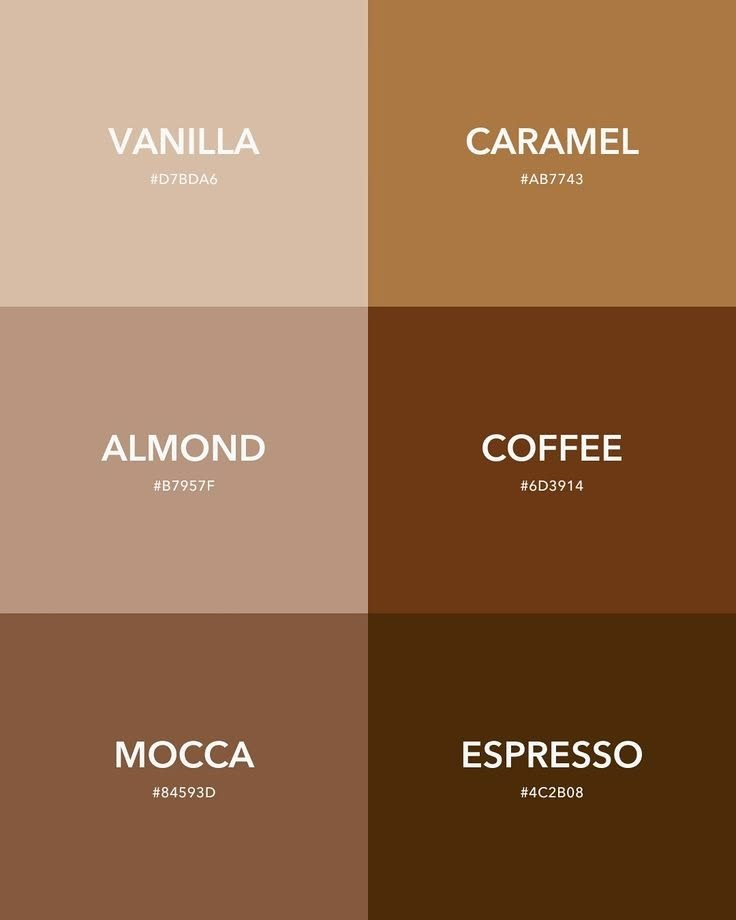
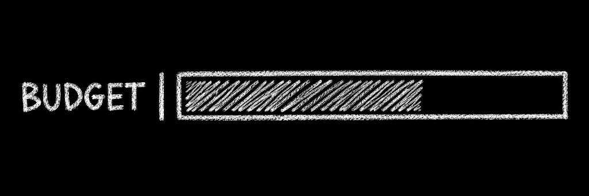
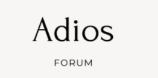

# Buno — Product Requirements

One line: A budgeting app that replaces exact remaining balances with qualitative spending zones (Safe / Cautious / Danger) to prevent end-of-month overspending, using a sketch-style health bar and human-readable notes.
Source: `scope.md > The Unique Kernel`, `scope.md > The Core Loop`, `scope.md > What "Working" Looks Like`.

## The Core Journey

1. **First visit — Intro & Premise**
   - User opens app → subtle entrance animation (bunny logo reveal + "Hello, this is Buno")
   - One screen explains the premise: qualitative zones over exact numbers, behavioral nudge over micromanagement
   - CTA: "Set your monthly budget"

2. **First visit — Budget Setup**
   - Single input: "Monthly budget (₹)" — numeric, required, saved to localStorage
   - Submit → immediate redirect to Zone tab

3. **Returning visit / Main view — Zone Tab (default)**
   - **Sketch-style health bar** (largest element): line-drawing aesthetic, coffee palette (beige lines on brown, varying density/length by zone), GSAP-animated transitions
   - **Zone label** (Safe / Cautious / Danger) — coffee-coded via line weight/style, not color
   - **Human note** — rotates among 3-4 variants per zone
   - **Monthly budget display** — static reference (e.g., "Monthly budget: ₹25,000")
   - **Tab navigation** → Activity tab

4. **Activity Tab**
   - **Transaction feed** — list rows: merchant/description, category icon, date/time, source badge (Bank / Cash)
   - **Empty state**: "There are no transactions here. Feel free to spend a little on yourself."
   - **Manual cash entry form** (inline or modal): amount (numeric, required, >0), description, date/time (default now), submit → GSAP bounce-in animation on new row, health bar updates with zone transition animation
   - **Refresh button** — simulates new pseudo-bank transactions (demo-friendly)

5. **Core Loop (repeat)**
   - User checks Zone tab daily/weekly → sees zone + note → optionally logs cash on Activity tab → watches health bar shift → feels nudge

6. **Danger Zone Exceeded**
   - When zone shifts to Danger (<20%): large GSAP "DANGER" animation + "Budget is empty now" message
   - If spending continues past 0%: health bar shows depletion beyond budget (negative zone), animation persists

## Screens and Layout

| Screen / Surface | Purpose | Key Elements |
|------------------|---------|--------------|
| **Intro / Premise** | First-visit onboarding | Animation, premise copy, "Set budget" CTA |
| **Budget Setup** | First-visit budget input | Single numeric input, submit |
| **Zone Tab** (default) | Daily health check | Health bar (sketch, animated), zone label, human note, monthly budget, tab nav |
| **Activity Tab** | Transaction log + cash entry | Feed (merchant, category icon, datetime, source), empty state, cash entry form, refresh button |
| **Danger Overlay** | Budget exceeded | Full-screen or prominent "DANGER" animation, "Budget is empty now" |

Single-page app with two tabs. No auth, no multi-user, no settings.

## Look and Feel

### Design & Visual References

#### 1. Color Palette (Coffee Theme)

The exact 6-tone coffee palette defined for Buno:
- **Vanilla** (`#D7BDA6`): Soft cream for primary background canvas, card highlights, and light accents.
- **Almond** (`#B7957F`): Neutral warm sand for borders, subtle dividers, and tertiary elements.
- **Mocca** (`#84593D`): Medium warm brown for inactive tabs, subheadings, and secondary icons.
- **Caramel** (`#AB7743`): Rich amber-brown accent for buttons, active indicator, and interactive cues.
- **Coffee** (`#6D3914`): Robust coffee brown for secondary headings, card outlines, and badge borders.
- **Espresso** (`#4C2B08`): Deepest dark roast for primary headings, body text, and heavy sketch strokes.

*Constraint*: Strictly **no zone colors** (no green/yellow/red). All states, including Danger, convey status through sketch density, line weight, and typography contrast within this palette.

#### 2. Sketch-Style Health Bar

- Hand-drawn chalk / sketch aesthetic: outlined rectangular container (`BUDGET | [ ... ]`) filled with textured diagonal hatch lines.
- Safe zone (>60%): Dense, rhythmic diagonal hatching filling the upper portion.
- Cautious zone (20%–60%): Sparser, lighter hatching with visible breathing room.
- Danger zone (<20%): Fragmented, erratic, or thinning scratch lines.
- Depleted (≤0%): Empty bar with persistent danger animation / overdraw.
- Transitions animated dynamically using GSAP morph / stroke drawing.

#### 3. Typography Reference

- **Display / Brand Headline**: Elegant serif font with high contrast and personality (inspired by "Adios" reference).
- **Labels / Navigation / Metadata**: Clean, tracked uppercase sans-serif (inspired by "FORUM" reference) for crisp legibility across numbers, dates, and category tags.

#### 4. Additional Style Notes
- **Bunny logo**: Subtle sketch-line bunny emblem, used in entrance animation and header.
- **Icons**: Hand-drawn / minimal single-stroke line icons for categories (food, transport, shopping, etc.) matching the Coffee/Espresso tones.
- **Feel**: Calm, human, intentional, analog craft. Not gamified, not corporate fintech.
- **GSAP Micro-interactions**: Smooth entrance reveal, health bar hatching morphs on zone transitions, cash entry bounce-in, and visceral Danger shake/overlay.

## Features and Behavior

### Zone Engine & Health Bar
- **Calculation**: Deterministic, rule-based. `remaining = budget - sum(all transactions)`. `pct = remaining / budget * 100`.
  - Safe: pct > 60%
  - Cautious: 20% ≤ pct ≤ 60%
  - Danger: pct < 20%
  - Beyond 0%: negative pct shown as "depleted" state
- **Health bar**: Visualizes zone via sketch lines. Animates on any zone change (GSAP).
- **Human note**: Rotates randomly among 3-4 variants per zone on each visit/refresh.
  - Safe: "You're in a safe spot with your spending. Enjoy." / "Breathing room looks good. Keep it steady." / "Nice buffer. No pressure."
  - Cautious: "You're drifting into the lower end. Worth a glance." / "Getting tighter. Maybe pause the non-essentials?" / "Middle ground. Decide what matters."
  - Danger: "You're in danger. I'd look at your spending right now." / "Red zone. Every rupee counts now." / "Deep in the danger zone. Time to stop."

### Pseudo Bank Sandbox
- Pre-loaded on first visit (after budget set) with ~15-20 fake transactions across categories/dates
- Mix of bank (UPI, card) and cash sources
- `Refresh` button: re-generates sandbox data (simulates new transactions for demo)

### Transaction Feed
- Columns: Description, Category (icon), Date/Time, Source (Bank/Cash badge)
- Sorted newest first
- Manual cash entries appear at top with bounce-in animation
- Empty state: human note ("There are no transactions here. Feel free to spend a little on yourself.")

### Manual Cash Entry
- Fields: Amount (number, required, min 1), Description (text, required), Date/Time (datetime-local, default now)
- Validation: blocks empty, negative, non-numeric
- Submit: adds to localStorage, prepends to feed with GSAP bounce, triggers health bar re-calc + animation

### Persistence
- **Budget**: localStorage (survives refresh)
- **Manual cash entries**: localStorage (survives refresh)
- **Pseudo-bank transactions**: regenerated on each load (not persisted) — refresh button re-generates

## States and Boundaries

- **First use (no budget in localStorage)** → Intro animation → Premise → Budget Setup → Zone Tab
- **Returning user (budget exists)** → Zone Tab (pseudo-bank auto-loads)
- **Empty transaction feed** → Human note: "There are no transactions here. Feel free to spend a little on yourself."
- **Cash entry validation error** → Inline error: "Enter a valid amount" / "Amount must be positive" / "Description required"
- **Danger zone (<20%)** → Zone label "Danger", health bar fragmented sketch, human note from danger set
- **Budget depleted (≤0%)** → Large GSAP "DANGER" animation + "Budget is empty now" overlay/message, health bar shows negative depletion
- **Tab navigation** → Zone ↔ Activity, preserves scroll/state
- **Refresh button** → Re-generates pseudo-bank data, re-renders feed, recalculates zone

## Product Decisions

- **Two tabs (Zone + Activity) not single page** — keeps kernel primary but adds substance for demo. Source: scope discussion.
- **Sketch-style health bar, coffee palette only** — no color-coded zones. Source: learner preference for minimalistic, "sketch marks" aesthetic.
- **Zone labels: Safe / Cautious / Danger** — softer than "Danger" alone, "Cautious" implies actionable middle ground. Source: learner.
- **No auth, no real bank API** — POC boundary. localStorage budget + sandbox. Source: `scope.md > Explicitly Cut`.
- **Human notes rotate** — avoids repetition, feels personal. Source: learner.
- **Danger overlay animation** — makes the "oh shit" moment visceral for demo. Source: learner.
- **Refresh simulates new transactions** — demo-friendly, shows zone shift. Source: learner.

## What We're Building

1. Intro animation + premise screen
2. Budget setup (single input → localStorage)
3. Zone tab: sketch health bar (GSAP), zone label, rotating human note, monthly budget display
4. Activity tab: transaction feed (merchant, category icon, datetime, source), empty state, manual cash entry form (validated, GSAP bounce-in), refresh button (regenerates sandbox)
5. Pseudo-bank sandbox: ~15-20 varied transactions, mixed sources
6. Zone engine: deterministic calculation, Safe >60% / Cautious 20-60% / Danger <20% / Depleted ≤0%
7. Danger exceeded: large GSAP animation + "Budget is empty now"
8. Coffee brown palette, minimal typography, bunny logo entrance
9. localStorage persistence for budget + manual entries

## Deferred From the POC

- **User authentication** (Google Auth) — adds significant complexity, not needed to prove kernel. Can be added post-hackathon.
- **Real bank API / UPI integration** — requires backend, credentials, compliance. Sandbox proves the concept.
- **Multiple budgets / accounts** — scope creep. One monthly budget is the kernel.
- **Historical trends / analytics** — not part of qualitative zone kernel.
- **Custom zone thresholds** — fixed thresholds keep it simple and opinionated.
- **Export / sharing / PWA** — demo doesn't need it.
- **Deployment** — optional per hackathon rules.

## Possible Later Enhancements

- Real bank sync (Plaid, Account Aggregator, UPI intent)
- Multi-device sync with auth
- Weekly/daily zone views
- Category spending breakdown (without exact numbers)
- Savings goal as separate zone
- Shared/household budgets
- Native mobile app

## Non-Goals

- Exact remaining balance display (violates kernel)
- Budget planner / goals / accounts pages (kernel is zone, not planning)
- Detailed categorization / tagging (adds friction)
- Multi-user / household budgets
- Notifications / alerts
- Deployment / hosting

## Open Questions

1. **Category icon set** — which categories? (Food, Transport, Shopping, Bills, Entertainment, Other?) → Can decide in `4-spec` with a standard set.
2. **Health bar sketch algorithm** — exact line density/weight rules per zone? → `4-spec` to define with GSAP drawSVG or canvas.
3. **Danger overlay** — full-screen modal? Inline expansion? → `4-spec` to decide based on demo impact.
4. **Pseudo-bank data structure** — fixed seed for demo consistency? → `4-spec` to define JSON shape.
5. **Review format for PRD** — learner profile has `not established`. HTML recommended (journey diagram, screen flow, state matrix). Confirm before generating `prd.html`.